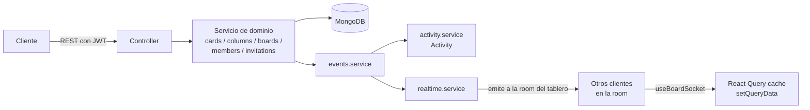
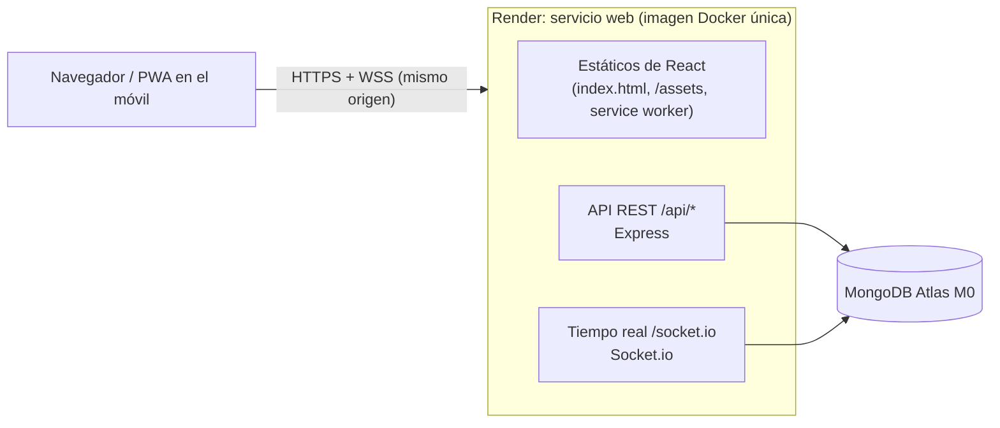

# MakeIt

[](https://github.com/czomeno/MakeIt/actions/workflows/ci.yml)
[](https://github.com/czomeno/MakeIt/actions/workflows/security.yml)
[](#política-de-cobertura)
[](#política-de-cobertura)
[](LICENSE)
[](.nvmrc)
[](https://TU-SERVICIO.onrender.com)
<!-- TODO: sustituye TU-SERVICIO por la URL real de Render (DEPLOY.md, apartado 4). -->

**Demo:** <https://TU-SERVICIO.onrender.com> · usuario `demo@makeit.app` (pídeme la
contraseña) · se puede instalar en el móvil como app.

Tablero Kanban colaborativo (tipo Trello) construido como proyecto de portfolio
full-stack: tableros con listas y tarjetas que se pueden reordenar, con varios
usuarios trabajando sobre el mismo tablero.

> **Estado: Fase 6 — desplegado.** MakeIt funciona en internet como un único
> servicio en Render (API + WebSocket + frontend, mismo origen) con MongoDB
> Atlas, y se instala en el móvil como PWA. Cada cambio pasa por la red de
> seguridad de la Fase 5 ([Calidad y CI](#calidad-y-ci)) antes de desplegarse.
> Ver [Despliegue](#despliegue) y la guía paso a paso [DEPLOY.md](DEPLOY.md).

## Stack

| Capa               | Tecnología                                                          |
| ------------------ | ------------------------------------------------------------------- |
| Frontend           | React 19 + Vite 6 + TypeScript                                      |
| Backend            | Node.js + Express 5 + TypeScript                                    |
| Tiempo real        | Socket.io                                                           |
| Base de datos      | MongoDB con Mongoose                                                |
| Contenedores       | Docker (imagen única de producción) + Docker Compose                |
| Tests              | Jest + Supertest, Vitest + Testing Library, Playwright              |
| Calidad            | ESLint 9 (flat config) + Prettier + Husky/lint-staged/commitlint    |
| CI/CD              | GitHub Actions + GitHub Container Registry                          |
| Observabilidad     | Logs estructurados con pino, `/api/health` y `/api/ready`           |
| Producción         | Render (servicio web Docker) + MongoDB Atlas, PWA (vite-plugin-pwa) |
| Gestor de paquetes | npm                                                                 |

## Requisitos

Para levantarlo con Docker (recomendado):

- Docker Engine 24+ con el plugin Docker Compose v2

Para ejecutarlo sin Docker:

- Node.js 24 (la versión de [`.nvmrc`](.nvmrc): `nvm use`) y npm
- Una instancia de MongoDB accesible (local o remota)

## Cómo levantarlo con Docker

Un único comando desde la raíz del repositorio:

```bash
docker compose up --build
```

No hace falta crear un `.env`: `docker-compose.yml` ya define valores por defecto
para todas las variables. Una vez arrancado:

- Cliente: http://localhost:5173
- API: http://localhost:4000/api/health
- MongoDB: `localhost:27017`

La página inicial consulta `/api/health` y muestra el estado de la API y de la
base de datos. El código de `/client` y `/server` está montado como volumen, así
que los cambios se recargan automáticamente sin reconstruir la imagen.

Comandos útiles:

```bash
docker compose up --build        # construir y arrancar
docker compose logs -f api       # seguir los logs de la API
docker compose down              # parar y eliminar los contenedores
docker compose down -v           # además, borrar los volúmenes (datos de Mongo y node_modules)
```

> El repo incluye un `Makefile` con atajos para estos comandos y para el
> flujo de desarrollo local (`make help` los lista todos; ver `MAKEFILE.md`
> para el detalle de cada uno). Por ejemplo: `make up`, `make health`,
> `make logs-api`, `make test`.

> `node_modules` de `api`/`client` vive en un volumen con nombre para que el
> `npm install` no se repita en cada arranque. Ese volumen no se actualiza al
> reconstruir la imagen, así que el contenedor de desarrollo compara al
> arrancar el hash de `package-lock.json` con el de la última instalación y,
> si cambió (alguien añadió una dependencia), ejecuta `npm ci` antes de
> levantar el servidor. No hace falta borrar volúmenes a mano.

## Cómo ejecutarlo sin Docker

Necesitas un MongoDB corriendo en local. Desde la raíz:

```bash
cp .env.example .env     # y ajusta MONGO_URI a mongodb://localhost:27017/kanban
```

La API lee el `.env` de la raíz del monorepo y también `server/.env`, si existe
(este último tiene prioridad).

En una terminal, la API:

```bash
cd server
npm install
npm run dev              # http://localhost:4000
```

En otra terminal, el cliente:

```bash
cd client
npm install
npm run dev              # http://localhost:5173
```

El servidor de desarrollo de Vite proxea `/api` hacia `http://localhost:4000`,
de modo que no hay que configurar nada más en el cliente.

### Scripts disponibles

En la raíz (orquestan los dos paquetes; ver [Calidad y CI](#calidad-y-ci)):

| Script                  | Descripción                                                       |
| ----------------------- | ----------------------------------------------------------------- |
| `npm run check`         | Formato + lint + tipos + tests unitarios (lo que comprueba el CI) |
| `npm run lint`          | ESLint en server y client (falla también con avisos)              |
| `npm run typecheck`     | `tsc --noEmit` en server, client y los specs e2e                  |
| `npm run format`        | Prettier `--write` en todo el repositorio                         |
| `npm test`              | Tests de server y client                                          |
| `npm run test:coverage` | Tests con cobertura; fallan si bajan del umbral                   |
| `npm run test:e2e`      | Playwright contra el stack de `docker-compose.e2e.yml`            |
| `npm run build`         | Build de server y client                                          |

En `/server`:

| Script                  | Descripción                                             |
| ----------------------- | ------------------------------------------------------- |
| `npm run dev`           | Arranca la API con recarga automática (`tsx watch`)     |
| `npm run build`         | Compila TypeScript a `dist/`                            |
| `npm start`             | Ejecuta la build de `dist/`                             |
| `npm run lint`          | Analiza el código con ESLint                            |
| `npm run typecheck`     | Comprueba los tipos (`tsc --noEmit`, incluye los tests) |
| `npm test`              | Ejecuta los tests (Jest + Supertest + Mongo en memoria) |
| `npm run test:coverage` | Tests con informe de cobertura                          |
| `npm run seed`          | Crea un usuario y un tablero de ejemplo                 |

En `/client`:

| Script                  | Descripción                                        |
| ----------------------- | -------------------------------------------------- |
| `npm run dev`           | Servidor de desarrollo de Vite                     |
| `npm run build`         | Comprueba los tipos y genera el bundle en `dist/`  |
| `npm run preview`       | Sirve en local el bundle de producción             |
| `npm run lint`          | Analiza el código con ESLint                       |
| `npm run typecheck`     | Comprueba los tipos (`tsc --noEmit`)               |
| `npm test`              | Ejecuta los tests (Vitest + Testing Library + MSW) |
| `npm run test:watch`    | Tests en modo observador                           |
| `npm run test:coverage` | Tests con informe de cobertura                     |

## Estructura de carpetas

```
.
├── client/                     # Aplicación React (SPA)
│   ├── src/
│   │   ├── api/                 # Cliente HTTP (client.ts) + funciones por recurso
│   │   ├── stores/               # Zustand: sesión (authStore) y toasts (toastStore)
│   │   ├── types/api.ts          # Formas de la API en un único sitio
│   │   ├── lib/queryClient.ts    # Instancia de React Query
│   │   ├── components/           # UI reutilizable: Button, Input, Modal...
│   │   ├── routes/                # ProtectedRoute, PublicRoute, AppRouter
│   │   ├── features/
│   │   │   ├── auth/              # LoginPage, RegisterPage
│   │   │   ├── boards/             # Lista, vista de tablero, modales
│   │   │   ├── columns/            # Columnas: crear, renombrar, borrar
│   │   │   ├── cards/              # Tarjetas: alta, detalle
│   │   │   ├── board/              # Drag & drop: Board, Sortable*, colisiones,
│   │   │   │                       # anuncios, coordinate getter de teclado,
│   │   │   │                       # useBoardSocket, remoteReducers
│   │   │   ├── members/            # Miembros, invitaciones, aceptar invitación
│   │   │   └── activity/           # Panel de actividad, frases en español
│   │   ├── socket/                # Singleton de socket.io-client + contrato
│   │   │                           # de eventos (duplicado del servidor)
│   │   ├── test/                  # Setup de Vitest + MSW + doble del socket
│   │   ├── App.tsx / main.tsx
│   │   └── index.css              # Tailwind v4
│   ├── index.html
│   ├── vite.config.ts          # Proxy de /api + configuración de Vitest
│   ├── tsconfig*.json
│   ├── eslint.config.js
│   ├── public/                 # Iconos de la PWA (logo.svg + PNG)
│   ├── Dockerfile              # Desarrollo (Vite); producción: Dockerfile de la raíz
│   └── .dockerignore
├── server/                     # API Express
│   ├── src/
│   │   ├── config/
│   │   │   ├── env.ts          # Carga con dotenv y validación con Zod
│   │   │   ├── db.ts           # Conexión (con reintentos) y estado de la BD
│   │   │   ├── logger.ts       # pino: niveles, redacción de datos sensibles
│   │   │   ├── version.ts      # Versión de la app (APP_VERSION o package.json)
│   │   │   └── lifecycle.ts    # Estado de apagado (para /api/ready)
│   │   ├── models/             # User, Board, Column, Card, RefreshToken,
│   │   │                       # Invitation, Activity
│   │   ├── schemas/             # Validación de entrada con Zod
│   │   ├── services/            # Lógica de negocio (auth, boards, columns,
│   │   │                        # cards, members, invitations, activity,
│   │   │                        # events [único punto que registra actividad
│   │   │                        # Y emite por socket], realtime)
│   │   ├── controllers/         # Manejadores de las rutas, delgados
│   │   ├── routes/              # Definición de rutas
│   │   ├── middleware/          # requireAuth, requireBoardRole, validate,
│   │   │                        # mutationId (cabecera X-Mutation-Id), errores
│   │   ├── socket/              # Servidor de Socket.io: handshake, rooms,
│   │   │                        # presencia, contrato de eventos
│   │   ├── mailer/               # Interfaz Mailer + ConsoleMailer (dev)
│   │   ├── errors/AppError.ts   # Error tipado con código HTTP y código de error
│   │   ├── utils/               # calculatePosition, tokens, password, hash...
│   │   ├── types/                # Augmentations de Express (req.user, req.boardId)
│   │   ├── app.ts               # Construcción de la app de Express
│   │   ├── scripts/             # db:indexes y seed:demo (operación, a mano)
│   │   ├── server.ts            # Arranque (http.Server + Socket.io) y señales
│   │   ├── shutdown.ts          # Apagado ordenado (HTTP, sockets, Mongo)
│   │   └── seed.ts              # npm run seed: usuario + tablero de ejemplo
│   ├── tests/                   # Jest + Supertest + mongodb-memory-server
│   ├── tsconfig.json / tsconfig.test.json
│   ├── jest.config.js
│   ├── eslint.config.js
│   ├── Dockerfile               # Multi-stage: deps, dev, build, prod
│   └── .dockerignore
├── e2e/                        # Tests end-to-end de Playwright (ver e2e/README.md)
├── scripts/                    # smoke.mjs (post-despliegue), política de npm audit, cobertura
├── .github/                    # Workflows (ci, security, release), Dependabot, plantillas
├── .husky/                     # Hooks de git: pre-commit (lint-staged) y commit-msg
├── docker-compose.yml          # Desarrollo: servicios client, api y mongo
├── Dockerfile                  # Imagen ÚNICA de producción (API + frontend)
├── render.yaml                 # Blueprint de Render (despliegue)
├── docker-compose.prod.yml     # Alternativa VPS (referencia) con Caddy
├── Caddyfile                   # Caddy: HTTPS automático delante de la app (VPS)
├── DEPLOY.md                   # Guía de despliegue paso a paso
├── docker-compose.e2e.yml      # Stack efímero para los tests e2e
├── playwright.config.ts
├── package.json                # Scripts unificados + herramientas de calidad
├── .env.production.example     # Variables del compose de producción
├── requests.http                # Peticiones de ejemplo para probar la API
├── .env.example                 # Todas las variables de entorno
├── .prettierrc                  # Configuración de Prettier compartida
├── .editorconfig / .nvmrc       # Estilo base del editor y versión de Node
├── commitlint.config.js / lint-staged.config.js
├── .gitignore
├── CONTRIBUTING.md / SECURITY.md / LICENSE
└── README.md
```

## Variables de entorno

Todas se validan con Zod al arrancar: si falta una obligatoria o un valor no
es válido, el proceso termina explicando qué falla. **En producción**
(`NODE_ENV=production`) además se exige: secretos JWT de 32 caracteres o más,
distintos entre sí y que no sean de ejemplo; `MONGO_URI` con
`mongodb://` o `mongodb+srv://`; y `APP_BASE_URL` con https. La plantilla de
producción comentada está en [`.env.production.example`](.env.production.example).

| Variable                                  | Por defecto                        | Producción (Render)                       | Descripción                                                                 |
| ----------------------------------------- | ---------------------------------- | ----------------------------------------- | --------------------------------------------------------------------------- |
| `NODE_ENV`                                | `development`                      | `production`                              | Entorno de ejecución                                                        |
| `PORT`                                    | `4000`                             | lo inyecta Render                         | Puerto en el que escucha la app                                             |
| `MONGO_URI`                               | —                                  | **secreto**: `mongodb+srv://...` de Atlas | Cadena de conexión (obligatoria)                                            |
| `JWT_ACCESS_SECRET`                       | —                                  | **secreto**: `openssl rand -base64 48`    | Secreto del access token (obligatoria)                                      |
| `JWT_REFRESH_SECRET`                      | —                                  | **secreto**: `openssl rand -base64 48`    | Secreto del refresh token (obligatoria, distinto del anterior)              |
| `APP_BASE_URL`                            | `http://localhost:5173`            | `https://<servicio>.onrender.com`         | URL pública: base de los enlaces de invitación y de la CSP                  |
| `SERVE_CLIENT`                            | `false`                            | `true` (ya en la imagen)                  | La API sirve también el frontend compilado                                  |
| `CLIENT_DIST_PATH`                        | `./public`                         | `/app/public` (ya en la imagen)           | Carpeta del frontend compilado                                              |
| `TRUST_PROXY`                             | `0`                                | `1`                                       | Proxies de confianza delante de la app (Render, Caddy)                      |
| `CORS_ORIGIN`                             | sin definir                        | sin definir                               | Solo si el cliente se sirve desde otro origen (desarrollo con Vite: `5173`) |
| `JWT_ACCESS_EXPIRES_IN`                   | `15m`                              | `15m`                                     | Vida del access token                                                       |
| `JWT_REFRESH_EXPIRES_IN`                  | `30d`                              | `30d`                                     | Vida del refresh token y de la cookie de sesión                             |
| `BCRYPT_ROUNDS`                           | `10`                               | `12`                                      | Coste de bcrypt para las contraseñas                                        |
| `INVITATION_EXPIRES_DAYS`                 | `7`                                | `7`                                       | Días hasta que caduca una invitación pendiente                              |
| `APP_NAME`                                | `MakeIt`                           | `MakeIt`                                  | Nombre usado en el asunto de las invitaciones                               |
| `SOCKET_PATH`                             | `/socket.io`                       | `/socket.io`                              | Path del servidor de Socket.io                                              |
| `LOG_LEVEL`                               | `info` (`silent` en tests)         | `info`                                    | Nivel de log: `fatal` … `trace` o `silent`                                  |
| `AUTH_RATE_LIMIT_MAX`                     | `20`                               | `20`                                      | Peticiones a `/api/auth` por IP cada 15 min                                 |
| `INVITATIONS_RATE_LIMIT_MAX`              | `30`                               | `30`                                      | Peticiones de invitaciones por IP cada 15 min                               |
| `SHUTDOWN_TIMEOUT_MS`                     | `10000`                            | `10000`                                   | Margen del apagado ordenado tras `SIGTERM`                                  |
| `APP_VERSION`                             | `RENDER_GIT_COMMIT` o package.json | la pone Render                            | Versión que informa `/api/health`                                           |
| `DEMO_USER_EMAIL` / `DEMO_USER_PASSWORD`  | `demo@makeit.app` / —              | no van en Render                          | Solo para `npm run seed:demo` (en tu ordenador)                             |
| `SMOKE_EMAIL` / `SMOKE_PASSWORD`          | —                                  | no van en Render                          | Solo para `npm run smoke` (en tu ordenador)                                 |
| `MONGO_DB` / `MONGO_PORT` / `CLIENT_PORT` | `kanban` / `27017` / `5173`        | —                                         | Solo para el `docker-compose.yml` de desarrollo                             |

## API

Todas las rutas van bajo `/api`. Las que requieren autenticación esperan
`Authorization: Bearer <accessToken>`; `/api/auth/refresh` y `/api/auth/logout`
leen en su lugar la cookie `httpOnly` `refreshToken`. Las respuestas de error
tienen la forma `{ "error": { "code", "message", "details"? } }`.

| Método   | Ruta                                   | Auth                                       | Descripción                                                         |
| -------- | -------------------------------------- | ------------------------------------------ | ------------------------------------------------------------------- |
| `GET`    | `/api/health`                          | —                                          | Liveness: estado, versión, uptime y estado de la base de datos      |
| `GET`    | `/api/ready`                           | —                                          | Readiness: 200 si puede atender tráfico; 503 sin Mongo o apagándose |
| `POST`   | `/api/auth/register`                   | —                                          | Crea una cuenta; devuelve `accessToken` + cookie refresh            |
| `POST`   | `/api/auth/login`                      | —                                          | Igual que arriba, validando credenciales                            |
| `POST`   | `/api/auth/refresh`                    | cookie refresh                             | Rota el refresh token; devuelve `accessToken` nuevo                 |
| `POST`   | `/api/auth/logout`                     | cookie refresh                             | Invalida el refresh token activo                                    |
| `GET`    | `/api/auth/me`                         | token                                      | Usuario autenticado                                                 |
| `GET`    | `/api/boards`                          | token                                      | Tableros donde el usuario es miembro                                |
| `POST`   | `/api/boards`                          | token                                      | Crea un tablero; el creador queda como `admin`                      |
| `GET`    | `/api/boards/:id`                      | token · viewer                             | Tablero con columnas y tarjetas ordenadas                           |
| `PATCH`  | `/api/boards/:id`                      | token · admin                              | Edita título/descripción                                            |
| `DELETE` | `/api/boards/:id`                      | token · admin                              | Borra el tablero y sus columnas/tarjetas (cascada)                  |
| `POST`   | `/api/boards/:boardId/columns`         | token · editor                             | Crea una columna                                                    |
| `PATCH`  | `/api/columns/:id`                     | token · editor                             | Edita una columna                                                   |
| `DELETE` | `/api/columns/:id`                     | token · editor                             | Borra la columna y sus tarjetas (cascada)                           |
| `PATCH`  | `/api/columns/:id/move`                | token · editor                             | Reordena la columna entre dos vecinas                               |
| `POST`   | `/api/columns/:columnId/cards`         | token · editor                             | Crea una tarjeta                                                    |
| `PATCH`  | `/api/cards/:id`                       | token · editor                             | Edita una tarjeta                                                   |
| `DELETE` | `/api/cards/:id`                       | token · editor                             | Borra una tarjeta                                                   |
| `PATCH`  | `/api/cards/:id/move`                  | token · editor                             | Mueve la tarjeta de columna y/o posición                            |
| `GET`    | `/api/boards/:boardId/activity`        | token · viewer                             | Historial del tablero, paginado por cursor                          |
| `GET`    | `/api/cards/:id/activity`              | token · viewer                             | Historial de una tarjeta, paginado por cursor                       |
| `GET`    | `/api/boards/:boardId/members`         | token · viewer                             | Miembros del tablero (id, nombre, email, rol)                       |
| `PATCH`  | `/api/boards/:boardId/members/:userId` | token · admin                              | Cambia el rol de un miembro                                         |
| `DELETE` | `/api/boards/:boardId/members/:userId` | token · admin (a otro) o el propio usuario | Expulsa o abandona                                                  |
| `POST`   | `/api/boards/:boardId/invitations`     | token · admin                              | Crea una invitación; devuelve el enlace con el token en claro       |
| `GET`    | `/api/boards/:boardId/invitations`     | token · admin                              | Invitaciones pendientes (no caducadas)                              |
| `DELETE` | `/api/invitations/:id`                 | token · admin                              | Revoca una invitación pendiente                                     |
| `POST`   | `/api/invitations/accept`              | token                                      | Acepta una invitación con `{ token }`; idempotente                  |

"viewer/editor/admin" es el rol mínimo exigido en ese tablero. Si el usuario no
es miembro del tablero, cualquiera de estas rutas responde `404` (no `403`,
para no revelar que el tablero existe). Las mutaciones (`POST`/`PATCH`/`DELETE`,
salvo `/auth/*`) aceptan una cabecera opcional `X-Mutation-Id`: viaja en el
payload del evento de socket correspondiente para que el cliente que originó
el cambio pueda ignorar su propio eco (ver "Colaboración y tiempo real").
`requests.http` en la raíz del repo tiene ejemplos listos para ejecutar con la
extensión REST Client de VS Code (o cualquier cliente compatible).

## Frontend

Stack: React + Vite + TypeScript estricto, React Router, TanStack Query,
Zustand, React Hook Form + Zod, Tailwind v4, dnd-kit, socket.io-client. Tests
con Vitest + Testing Library + MSW (socket mockeado, ver `test/socketMock.ts`).

### Interfaz y tema

Rediseño ("Makeit") inspirado en un panel de seguimiento de tareas: sidebar
oscuro fijo (logo, "Mis tableros", "+ Nuevo tablero") y contenido claro u
oscuro según el interruptor de la cabecera. El tema se guarda en
`localStorage` (store `themeStore.ts`, con `zustand/persist`) y, si no hay
preferencia guardada, arranca según `prefers-color-scheme` del sistema. Las
etiquetas de las tarjetas y el avatar de la empresa usan un color
determinista por texto (`lib/badgeColors.ts`): mismo texto, mismo color
siempre, sin guardar un campo de color en el modelo de datos.

### Cómo se gestiona la sesión

- El **access token vive solo en memoria**, en un store de Zustand
  (`stores/authStore.ts`). Nunca se escribe en `localStorage` ni
  `sessionStorage`: si se recarga la página o se abre una pestaña nueva, no
  queda rastro de él en el navegador.
- El **refresh token vive en una cookie `httpOnly`** que gestiona el
  servidor; JavaScript no puede leerla ni manipularla. El cliente HTTP
  (`api/client.ts`) usa `credentials: 'include'` en cada petición para que el
  navegador la envíe y reciba sola.
- Al cargar la app (`App.tsx`), se llama una vez a `POST /api/auth/refresh`
  mientras se muestra una pantalla de carga de página completa. Si hay cookie
  válida, se recupera el access token y el usuario (`GET /api/auth/me`) sin
  que el usuario tenga que volver a iniciar sesión; si no, pasa a
  `unauthenticated` y `ProtectedRoute` redirige a `/login`.
- Si una petición autenticada responde `401` (access token caducado),
  `api/client.ts` hace **un único** `POST /api/auth/refresh` y reintenta esa
  petición una sola vez. Varias peticiones que fallan a la vez (p. ej. al
  recargar con varias queries en paralelo) comparten la misma promesa de
  refresh en lugar de disparar varias llamadas — ver "Decisiones técnicas".
  Si el refresh también falla, se limpia la sesión y `ProtectedRoute`
  redirige a `/login` de forma reactiva (no hay un `window.location.href`
  manual en medio de la lógica de red).
- `logout` llama a `POST /api/auth/logout` y limpia la sesión y la cache de
  React Query (`queryClient.clear()`) tanto si la petición tiene éxito como
  si falla: la sesión local no debe quedar "colgada" por un fallo de red.

### Capturas de pantalla

<!-- TODO: añade las capturas en docs/screenshots/ y descomenta las líneas. -->

| Escritorio                                                                                             | Móvil (PWA instalada)                                                                                       |
| ------------------------------------------------------------------------------------------------------ | ----------------------------------------------------------------------------------------------------------- |
| <!--  --> _Pendiente: lista de tableros_ | <!--  --> _Pendiente: lista de tableros_        |
| <!--  --> _Pendiente: un tablero con tarjetas_      | <!--  --> _Pendiente: un tablero_                 |
| <!--  --> _Pendiente: inicio de sesión_                 | <!--  --> _Pendiente: «Añadir a pantalla de inicio»_ |

### Arrastrar y soltar (drag & drop)

Tarjetas (dentro de una columna, entre columnas, a una vacía) y columnas
(para reordenarlas) se arrastran con [dnd-kit](https://dndkit.com/). Todo el
código vive en `features/board/`:

- **`boardReducers.ts`**: la lógica pura (sin React ni dnd-kit) que mueve
  tarjetas/columnas dentro de la estructura del tablero y deriva lo que hay
  que mandarle a la API. Se apoya en el **orden del array**, no en `position`:
  mover una tarjeta es recortarla de un array e insertarla en otro por
  índice, así que la vista previa durante el arrastre nunca necesita conocer
  ni recalcular posiciones numéricas.
- **El contrato con el backend no cambió**: `PATCH /api/cards/:id/move` y
  `PATCH /api/columns/:id/move` ya recibían ids de vecinos (`prevCardId` /
  `nextCardId`, o sus equivalentes de columna) y devuelven el servidor
  calculando la posición — nunca un número calculado por el cliente. El
  cliente solo deriva esos ids a partir del índice donde soltaste (ver
  `cardMoveApiInput` / `columnMoveApiInput`).
- **Rebalanceo de `position` (ajuste de backend de esta fase)**: cada
  movimiento biseca el hueco entre dos vecinos (`calculatePosition`); tras
  muchas inserciones seguidas en el mismo hueco, ese punto medio se vuelve
  indistinguible de sus vecinos en punto flotante. Si el hueco baja de un
  umbral, el servidor renumera **todos** los hermanos (de la columna, o del
  tablero) como múltiplos de 1000 en vez de seguir biseccionando —
  transparente para el cliente, que siempre refresca el tablero tras cada
  movimiento.
- **Estrategia de colisiones propia**: prioriza una tarjeta concreta bajo el
  puntero sobre la columna que la contiene (inserción precisa), con la
  columna como respaldo para huecos y columnas vacías, y `rectIntersection`
  como última red si el puntero se sale un instante durante un arrastre
  rápido.
- **Teclado**: `KeyboardSensor` con un _coordinate getter_ propio — cada
  columna tiene su propio `SortableContext` vertical, así que ↑/↓ reordena
  dentro de la columna y ←/→ salta a la columna vecina.

### Vista de lista (alternativa al arrastre)

Cada tablero tiene un selector **Tablero / Lista** sobre el propio tablero
(`BoardPage.tsx`). La vista de lista (`features/board/BoardListView.tsx`)
muestra todas las tarjetas en una sola columna, sin arrastre: a la derecha de
cada tarjeta hay un botón por cada categoría del tablero, coloreado igual que
sus etiquetas, con la categoría actual marcada con un anillo; pulsar otro
botón mueve la tarjeta al final de esa columna. Reutiliza exactamente el
mismo `useMoveCardMutation`/`applyCardMove`/`cardMoveApiInput` que el
arrastre — la lógica de `boardReducers.ts` no sabe ni le importa si el
movimiento vino de un gesto de arrastre o de un clic, así que ambas vistas
quedan siempre sincronizadas entre sí.

### GIF de demostración

_Pendiente: grabar un GIF arrastrando una tarjeta entre columnas._

<!-- TODO: docs/colaboracion.gif — dos ventanas (o ordenador + móvil) con
el mismo tablero: mover una tarjeta en una y verla moverse sola en la otra. -->

_Pendiente: GIF con dos ventanas mostrando la colaboración en vivo (mover una
tarjeta en una y verla actualizarse al instante en la otra)._

## Colaboración y tiempo real

Varias personas pueden trabajar a la vez en el mismo tablero: invitaciones
por enlace con rol, gestión de miembros, historial de actividad y
sincronización en vivo con [Socket.io](https://socket.io/). La lógica de
tiempo real está escrita para ser independiente del layout visual (opera
sobre la cache de React Query, no sobre el DOM del tablero), así que el
rediseño de una fase posterior no debería tener que tocarla.

### Flujo



- **Las escrituras siempre van por REST**; el socket solo difunde. El cliente
  que origina el cambio ya tiene su propia respuesta (optimista, desde la
  Fase 3) y no depende del socket para verse a sí mismo — ver "Decisiones
  técnicas" para el porqué.
- **`events.service.publish(...)`** es el único punto desde el que se
  registra actividad y se emite por socket; lo llaman los servicios de
  dominio tras cada mutación con éxito, nunca los controllers, así no se
  olvida ningún caso. `board:updated`/`board:deleted` son la excepción: no
  hay tipo de actividad para el tablero en sí (Parte 2 solo cubre tarjetas,
  columnas y miembros), así que `boards.service` emite directo por
  `realtime.service`.

### Eventos de socket

Autenticación en el handshake con el access token JWT (`auth: { token }`,
verificado con la misma lógica que `requireAuth`); sin token válido se
rechaza la conexión. `board:join { boardId }` solo admite a quien es miembro
(comprobado en Mongo) y une al socket a la room `board:{id}`; un no-miembro
recibe `{ error: 'FORBIDDEN' }` sin que se revele si el tablero existe.
`board:leave { boardId }` es el inverso. El contrato completo
(`SocketEventPayloads`) vive en `server/src/socket/events.ts`, duplicado
literalmente en `client/src/socket/events.ts` (el cliente no puede importar
código del servidor en el build de Vite); un test en ambos lados compara los
dos archivos para detectar divergencias.

| Evento             | Payload                                                |
| ------------------ | ------------------------------------------------------ |
| `card:created`     | `{ card, actorId, clientId? }`                         |
| `card:updated`     | `{ card, actorId, clientId? }`                         |
| `card:moved`       | `{ card, actorId, clientId? }`                         |
| `card:deleted`     | `{ cardId, columnId, actorId, clientId? }`             |
| `column:created`   | `{ column, actorId, clientId? }`                       |
| `column:updated`   | `{ column, actorId, clientId? }`                       |
| `column:moved`     | `{ column, actorId, clientId? }`                       |
| `column:deleted`   | `{ columnId, actorId, clientId? }`                     |
| `board:updated`    | `{ board, actorId, clientId? }`                        |
| `board:deleted`    | `{ boardId, actorId }`                                 |
| `member:joined`    | `{ member: { userId, role, name?, email? }, actorId }` |
| `member:updated`   | `{ member: { userId, role, name?, email? }, actorId }` |
| `member:removed`   | `{ userId, actorId }`                                  |
| `activity:created` | `{ activity }`                                         |
| `presence:update`  | `{ users: [{ userId, name, initials }] }`              |

`clientId` es el `TAB_ID` del cliente que originó el cambio (una cadena
aleatoria por pestaña, generada una vez al cargar `socket/clientId.ts`, no
por usuario) — viaja como cabecera `X-Mutation-Id` en la petición REST y
vuelve en el payload del evento. `useBoardSocket` lo compara con su propio
`TAB_ID` para ignorar el eco de sus propias mutaciones **sin** ignorar las de
otra pestaña del mismo usuario (que sí debe actualizarse).

**Presencia**: `socket/presence.ts` mantiene un `Map<boardId, Map<userId,
Set<socketId>>>` en memoria; varias pestañas del mismo usuario cuentan como
una sola conexión y solo desaparecen de la lista cuando se cierra la
última. Se emite `presence:update` al entrar, salir o desconectarse.

**Límites**: `maxHttpBufferSize` bajo (los únicos eventos de cliente son
`board:join`/`board:leave`, con un id) y una ventana deslizante simple en
memoria por `socket.id` para limitar la frecuencia de esos dos eventos.

**Escalar a varias instancias (no implementado, solo documentado)**: con más
de un proceso de la API, cada uno tendría su propio Map de presencia y sus
propias rooms en memoria — un cliente conectado a la instancia A nunca
recibiría los eventos emitidos desde la instancia B. Haría falta el
[adapter de Redis para Socket.io](https://socket.io/docs/v4/redis-adapter/)
(`@socket.io/redis-adapter`), que reemplaza el adapter en memoria por uno
que publica/suscribe los eventos entre instancias vía Redis.

### Invitaciones

`POST /api/boards/:boardId/invitations` genera un token aleatorio
(`crypto.randomBytes(32)`), guarda solo su hash SHA-256 (`Invitation.tokenHash`,
igual que `RefreshToken`) y devuelve el token en claro **una vez**, dentro del
enlace `APP_BASE_URL/invite/<token>`. No se envían emails reales: la interfaz
`Mailer` (`server/src/mailer/Mailer.ts`) tiene una implementación de
desarrollo (`ConsoleMailer`) que escribe el mensaje en los logs del servidor,
lista para sustituirse por un proveedor real sin tocar quien la usa.

La ruta `/invite/:token` del cliente vive bajo `ProtectedRoute`: si no hay
sesión, el redirect habitual a `/login` (con `state: { from: location }`) ya
hace que, tras iniciar sesión o registrarse, se vuelva exactamente a esa URL
y se acepte la invitación automáticamente. Pantallas para token inválido,
caducado, revocado o ya usado; aceptar dos veces es idempotente (no duplica
el miembro).

**Reglas de integridad**: el tablero siempre conserva al menos un admin (no
se puede degradar, expulsar ni abandonar siendo el último) y el propietario
original nunca puede ser expulsado (sí se le puede cambiar el rol si queda
otro admin). `members.service.ts` centraliza ambas comprobaciones.

### Actividad

Un historial por tablero (y uno filtrado por tarjeta) de qué pasó, quién y
cuándo, con paginación por cursor (`createdAt` del último elemento,
descendente). Los tipos registrados: `card.created/updated/moved/deleted`,
`column.created/renamed/moved/deleted`, `member.joined/left/removed/role_changed`.
`data` guarda **títulos y nombres en el momento del evento**, no referencias,
así el historial sigue teniendo sentido aunque la tarjeta/columna se borre o
se renombre después.

**Agrupado de ruido**: si la actividad más reciente de una tarjeta ya es un
`card.updated` del mismo autor hace menos de 60 segundos, el nuevo evento se
funde en esa fila (mismo `createdAt`, `data` actualizada) en vez de crear una
nueva — pensado para ediciones de contenido seguidas (escribir una
descripción, corregir un título). El resto de tipos nunca se agrupan: crear,
mover, borrar o los eventos de miembros son hechos discretos que se esperan
ver todos.

**Retención**: índice TTL sobre `createdAt` a 180 días (mismo patrón que
`RefreshToken`), para que la colección no crezca sin límite.

## Despliegue

MakeIt está desplegado gratis como **un único servicio web en Render**
(imagen Docker con la API REST, el WebSocket de Socket.io y el frontend
compilado, todo desde el mismo origen) y **MongoDB Atlas M0**. La guía
completa, paso a paso y pensada para quien no ha desplegado nunca, está en
**[DEPLOY.md](DEPLOY.md)**: Atlas con un usuario de permisos mínimos,
secretos, Blueprint de Render, variables, errores típicos, prueba en el
móvil, seguridad, dominio propio, copias de seguridad y la alternativa VPS.



| Pieza           | Archivo                                                                         |
| --------------- | ------------------------------------------------------------------------------- |
| Imagen única    | [`Dockerfile`](Dockerfile)                                                      |
| Blueprint       | [`render.yaml`](render.yaml) (despliega solo si el CI pasa)                     |
| Variables       | [`.env.production.example`](.env.production.example)                            |
| Índices / demo  | `npm run db:indexes` / `npm run seed:demo` (en `server/`)                       |
| Smoke test      | `npm run smoke -- <url>`                                                        |
| Alternativa VPS | [`docker-compose.prod.yml`](docker-compose.prod.yml) + [`Caddyfile`](Caddyfile) |

**En el móvil.** MakeIt es una **PWA instalable** («Añadir a pantalla de
inicio» en iOS y Android): icono propio, pantalla completa y sesión que
persiste al cerrar y reabrir. El service worker solo guarda el esqueleto de
la app; los datos siempre vienen del servidor. Cuando hay una versión nueva,
la app avisa con un botón **Recargar**.

**Arranque en frío.** En el plan gratuito el servicio se duerme tras un rato
sin tráfico. Si una petición tarda, la app muestra «Despertando el servidor,
puede tardar hasta un minuto…», reintenta los `502`/`503` del proxy sin
perder la sesión, y el socket reconecta solo.

### Antes de compartir el enlace en mi CV

- [ ] La URL de la demo está en el badge y en la línea «Demo» de arriba.
- [ ] `npm run smoke -- <url>` termina en `Smoke test OK`.
- [ ] La lista de seguridad de [DEPLOY.md](DEPLOY.md#8-lista-de-seguridad-antes-de-compartir-la-url)
      está completa (secretos propios, usuario limitado en Atlas, cookie
      `Secure`, cabeceras, rate limiting, `trust proxy` verificado).
- [ ] La cuenta demo existe (`seed:demo`), su contraseña es larga y su tablero
      está ordenado.
- [ ] Probado en un móvil real: instalar, cerrar y reabrir con la sesión
      iniciada, y colaboración en vivo con el ordenador.
- [ ] Capturas de escritorio y móvil, y GIF de colaboración añadidos (huecos
      marcados en [Capturas de pantalla](#capturas-de-pantalla) y
      [GIF de demostración](#gif-de-demostración)).
- [ ] El CI de `main` está en verde (badge de arriba) y la rama `main` está
      protegida con `ci-ok`.
- [ ] Abierta en una ventana de incógnito y en Safari: la primera carga
      (tras dormirse el servicio) muestra el aviso y luego funciona.

## Calidad y CI

Ningún cambio llega a `main` sin pasar una red de seguridad automática. En
local, `npm run check` ejecuta lo mismo que la primera parte del CI.

### Workflows

| Workflow                                         | Cuándo                                    | Qué comprueba                                                                                                                                                                                                                                                                                                       |
| ------------------------------------------------ | ----------------------------------------- | ------------------------------------------------------------------------------------------------------------------------------------------------------------------------------------------------------------------------------------------------------------------------------------------------------------------- |
| [`ci.yml`](.github/workflows/ci.yml)             | Push a `main` y cada pull request         | `lint-typecheck` (Prettier, ESLint, tsc), `test-server` y `test-client` (con umbral de cobertura, informe como artefacto), `build`, `docker` (la imagen única de producción con Buildx y caché, sin publicar), `e2e` (Playwright contra esa misma imagen; solo si todo lo anterior pasa) y `ci-ok`, que los resume. |
| [`security.yml`](.github/workflows/security.yml) | Pull requests, push a `main` y cada lunes | `npm audit` (raíz, server, client), CodeQL (JavaScript/TypeScript), gitleaks sobre todo el historial, Trivy sobre la imagen de producción y revisión de dependencias en los pull requests.                                                                                                                          |
| [`release.yml`](.github/workflows/release.yml)   | Push a `main` y tags `v*`                 | Publica la imagen única en `ghcr.io/czomeno/makeit` con tags `latest` y `sha-<commit>` (main) o semver (`1.2.3`, `1.2`), para la alternativa VPS. No despliega: Render despliega solo cuando los checks pasan (`render.yaml`).                                                                                      |
| [`dependabot.yml`](.github/dependabot.yml)       | Semanal (lunes)                           | Actualizaciones agrupadas de npm (raíz, server, client), GitHub Actions, imágenes de Docker y de Compose.                                                                                                                                                                                                           |

Todos los workflows tienen `permissions: contents: read` por defecto (solo
los jobs que lo necesitan amplían permisos), `concurrency` para cancelar
ejecuciones obsoletas de la misma rama y las actions fijadas por SHA.

### Cómo ejecutar cada tipo de test en local

```bash
npm install && npm install --prefix server && npm install --prefix client   # una vez

npm run check                 # formato + lint + tipos + tests unitarios
npm test --prefix server      # API: Jest + Supertest + Mongo en memoria
npm test --prefix client      # cliente: Vitest + Testing Library + MSW
npm run test:coverage         # ambos con cobertura (y umbrales)
npx playwright install chromium && npm run test:e2e   # e2e (necesita Docker)
```

Los e2e están documentados en [`e2e/README.md`](e2e/README.md): qué cubre cada
flujo, cómo depurarlos (`--ui`, trazas) y las reglas de la suite.

### Hooks de git

Husky instala dos hooks al hacer `npm install` en la raíz:

- **pre-commit**: `lint-staged` ejecuta ESLint (`--fix`) y Prettier solo sobre
  los archivos en staging. Tarda un par de segundos.
- **commit-msg**: commitlint exige [Conventional Commits](https://www.conventionalcommits.org/es/)
  (`feat(client): ...`, `fix: ...`).

Los tests completos no van en los hooks: los ejecuta el CI (ver Decisiones
técnicas).

### Política de cobertura

| Paquete  | Líneas | Sentencias | Funciones | Ramas |
| -------- | ------ | ---------- | --------- | ----- |
| `server` | 90 %   | 90 %       | 90 %      | 75 %  |
| `client` | 72 %   | 72 %       | 72 %      | 60 %  |

Son mínimos, configurados en `server/jest.config.js` y `client/vite.config.ts`:
si la cobertura baja de ahí, `npm run test:coverage` falla y el CI también.
Están unos puntos por debajo de la cobertura real para no frenar cambios
legítimos. En el cliente, el arrastre de dnd-kit no se puede ejercitar en
jsdom; esa parte la cubren los e2e. El objetivo no es el 100 %, sino cubrir
el comportamiento importante: autorización por rol, invitaciones, sockets,
posiciones y rebalanceo, mutaciones optimistas y estados de error. Cada job
publica la tabla de cobertura en su resumen y el informe completo como
artefacto.

### Política de seguridad

- **Dependencias (`npm audit`)**: el CI falla solo si hay vulnerabilidades
  **altas o críticas con una versión corregida disponible**
  ([`scripts/audit-policy.mjs`](scripts/audit-policy.mjs)). Las que no tienen
  arreglo se muestran como aviso: no hay nada que actualizar todavía, y
  Dependabot abrirá el PR cuando exista. Las moderadas y bajas las gestiona
  Dependabot sin bloquear.
- **Código**: CodeQL con el conjunto `security-extended`.
- **Secretos**: gitleaks recorre todo el historial en cada PR, en `main` y
  cada semana.
- **Imágenes**: Trivy falla con vulnerabilidades CRITICAL/HIGH que ya tienen
  parche (`--ignore-unfixed`). La imagen de producción corre sin root,
  sin npm y con versión de base fija.
- **Reporte de vulnerabilidades**: ver [SECURITY.md](SECURITY.md).

### Imagen de producción

Una **única imagen** ([`Dockerfile`](Dockerfile) de la raíz) con la API y el
frontend compilado: Node 24 Alpine, solo dependencias de producción, usuario
`node`, sin npm, `HEALTHCHECK` contra `/api/ready` y arranque directo con
`node` (para que `SIGTERM` llegue al proceso). Con `SERVE_CLIENT=true`, Express
sirve los estáticos con caché inmutable para `/assets`, `index.html` sin caché
y fallback a `index.html` para el router de React; `/api` y `/socket.io` tienen
prioridad, y una ruta de `/api` inexistente es un 404 JSON. Respuestas con
gzip. Es lo que se despliega, lo que prueban los e2e y lo que escanea Trivy.

```bash
docker build -t makeit .
npm run smoke -- http://localhost:<puerto> --env-file .env.smoke.local
```

### Observabilidad

- Logs JSON con [pino](https://getpino.io): nivel con `LOG_LEVEL`, un
  `X-Request-Id` por petición (se reutiliza el que mande un proxy), la IP del cliente y redacción
  de contraseñas, tokens, cookies y cabecera `Authorization`.
- `GET /api/health` (liveness) y `GET /api/ready` (readiness, 503 sin Mongo o
  durante el apagado).
- Si Mongo no está disponible al arrancar, la API reintenta conectar con
  espera creciente en lugar de quedarse sin base de datos para siempre.
- Al recibir `SIGTERM`, la API deja de aceptar conexiones, termina las
  peticiones en curso, cierra los sockets y la conexión a Mongo, y sale. Los
  errores no capturados se registran y provocan un apagado ordenado con
  código 1.

### Protección de la rama `main` (configuración manual en GitHub)

En **Settings → Branches → Add branch ruleset** (o _Branch protection rule_)
para `main`:

- **Require a pull request before merging.**
- **Require status checks to pass**: añade solo **`ci-ok`**.
- **Require branches to be up to date before merging.**
- **Block force pushes** y **Restrict deletions**.
- Opcional: también los checks de `Seguridad` (`CodeQL`, `Secretos
(gitleaks)`...) si quieres que bloqueen el merge.

## Decisiones técnicas

- **Columnas y tarjetas en colecciones separadas, no embebidas en `Board`.**
  Con tableros colaborativos, embeber tarjetas en el documento del tablero
  obligaría a reescribir ese documento completo en cada movimiento —riesgo de
  condiciones de carrera entre usuarios editando a la vez— y no permitiría
  indexar ni paginar tarjetas de forma independiente. Con referencias, cada
  movimiento es un `update` puntual por `_id`, e índices compuestos como
  `{ column: 1, position: 1 }` hacen barata la consulta "tarjetas de esta
  columna, en orden".
- **`calculatePosition(prev, next)` como punto medio entre vecinos**, en vez de
  un entero secuencial. Insertar o mover un elemento solo actualiza su propia
  fila; nunca hace falta renumerar el resto de la lista. Limitación conocida y
  aceptada en esta fase: tras muchísimas inserciones consecutivas en el mismo
  hueco, la precisión de punto flotante se agota (necesitaría un rebalanceo
  periódico, fuera de alcance de la Fase 1).
- **Refresh token como JWT con `jti`, no un simple valor aleatorio.** Permite
  verificar la firma y la expiración sin consultar la base de datos antes de
  mirar la tabla de revocación. Solo se guarda en Mongo el hash SHA-256 del
  token (nunca el valor en claro) junto con su `jti`, y cada `/refresh` borra
  la fila usada y crea una nueva (rotación): un token robado y luego usado por
  su dueño legítimo invalida la copia del atacante en el siguiente refresh.
- **`bcryptjs` en vez de `bcrypt`.** Implementación en JavaScript puro: evita
  añadir un toolchain de compilación nativa a la imagen `node:24-alpine`.
- **No-miembro → 404, miembro sin rol suficiente → 403.** Un no-miembro no
  debe poder confirmar que un tablero existe; un miembro ya sabe que existe,
  así que un 403 no filtra información nueva.
- **Autorización centralizada en `requireBoardRole(minRole, resolveBoardId)`.**
  El resolver recibe la request y devuelve el id del tablero, bien directo
  (`req.params.id`) o cargando primero la columna/tarjeta padre. Así la lógica
  de "verificar membresía + rango de rol" vive en un solo sitio para los tres
  recursos.
- **Controllers delgados, lógica en `services/`.** Los controllers solo leen
  la request, llaman al servicio correspondiente y dan forma a la respuesta;
  las reglas de negocio (cascadas, siembra de plantillas, validaciones cruzadas
  entre tablero/columna/tarjeta) viven en `services/`, reutilizables y testeables
  sin pasar por HTTP.
- **TanStack Query para el estado de servidor, Zustand solo para sesión y
  toasts.** Tableros, columnas y tarjetas vienen siempre de la API: React
  Query ya resuelve cache, invalidación y los estados de carga/error que
  pide el enunciado, sin reinventar nada de eso a mano. Zustand se usa
  únicamente para los dos trozos de estado que _no_ son del servidor (el
  usuario autenticado y los toasts); mezclar ambos en un solo store habría
  forzado a sincronizar manualmente algo que React Query ya gestiona.
- **Access token en memoria (Zustand) y refresh en cookie `httpOnly`.**
  Guardar el access token en `localStorage`/`sessionStorage` lo expone a
  cualquier script que corra en la página (XSS); en memoria desaparece al
  cerrar la pestaña o recargar, y se recupera en el acto con `/auth/refresh`
  gracias a la cookie, que JavaScript nunca llega a tocar. Es el mismo
  reparto de responsabilidades que ya tenía el backend desde la Fase 1
  (cookie `httpOnly` + rotación del refresh); el cliente solo tenía que
  respetarlo.
- **Un único refresh para varias peticiones 401 simultáneas.**
  `api/client.ts` guarda la promesa del refresh en curso en una variable de
  módulo (`refreshPromise`). La primera petición que recibe un 401 crea esa
  promesa y lanza el `POST /auth/refresh`; cualquier otra petición que falle
  mientras tanto reutiliza la misma promesa en vez de disparar su propio
  refresh. Al resolverse (o fallar), la variable se limpia en un `finally`
  para que el siguiente 401 pueda abrir un refresh nuevo.
- **`CardDetailModal` deriva la tarjeta activa por id, no por una copia
  guardada.** `BoardPage` guarda solo `activeCardId` y busca la tarjeta en
  los datos ya cargados del tablero en cada render; así, tras guardar o
  mover la tarjeta, el modal siempre muestra los datos frescos que llegan al
  invalidar la query, en vez de una foto fija del momento en que se abrió.
- **`Modal` escucha Escape en `document`, no solo en el propio contenedor.**
  La primera versión cerraba el diálogo con un `onKeyDown` en el contenedor,
  que depende de que el foco esté dentro; tras una mutación que vuelve a
  renderizar el contenido, el foco puede acabar fuera del diálogo y Escape
  dejaba de hacer nada. Encontrado verificando el flujo completo en un
  navegador real (en la Fase 2, antes de que esta pantalla tuviera drag & drop).
- **dnd-kit, no `react-beautiful-dnd`.** `react-beautiful-dnd` está
  archivada y sin mantenimiento; dnd-kit sigue activa, no depende de
  `react-dom`'s legacy APIs, y separa limpio sensores / detección de
  colisiones / estrategia de orden, que es justo lo que hacía falta
  personalizar aquí (colisiones propias, `KeyboardSensor` con coordinate
  getter a medida).
- **Posiciones numéricas con punto medio, no reescribir índices.** Si el
  orden se guardara como un índice entero por tarjeta (0, 1, 2...), mover una
  tarjeta al principio de una columna con 50 tarjetas implicaría reescribir
  las 50. Con `position` numérica y `calculatePosition(prev, next)`, mover
  una tarjeta es _una_ escritura: la suya. El coste es el de siempre con
  claves flotantes (el hueco se agota tras muchas inserciones seguidas en el
  mismo sitio), resuelto con el rebalanceo descrito arriba — mismo
  compromiso que ya se documentó en la Fase 1, ahora con la pieza que
  faltaba.
- **Cómo se evitan condiciones de carrera entre arrastres.** Dos cosas
  combinadas: (1) `scope: { id: 'board-' + boardId }` en las mutaciones de
  mover — TanStack Query encola las mutaciones del mismo scope, así que dos
  arrastres seguidos sobre el mismo tablero nunca corren en paralelo ni se
  pisan; (2) el estado visual del arrastre (`dragPreview` en `Board.tsx`) es
  independiente de la cache y no se limpia hasta que **todas** las
  mutaciones de arrastre en curso han asentado (contador de pendientes), así
  que aunque la segunda mutación quede esperando en la cola, la pantalla
  nunca "retrocede" al orden anterior mientras espera — ver la sección de
  drag & drop más arriba para el detalle completo.
- **El socket solo difunde; las escrituras siempre van por REST.** Si las
  mutaciones también pudieran llegar por socket, habría dos caminos de
  validación/autorización/Zod que mantener sincronizados. Con un único
  camino de escritura, el cliente que origina un cambio ya tiene su propia
  respuesta (optimista, desde la Fase 3) sin depender del socket para verse
  a sí mismo, y el socket se reduce a "avisar a los demás" — más simple y
  con una sola fuente de verdad para los permisos.
- **Eco propio por `clientId` de pestaña, no por `actorId`.** Comparar solo
  por `actorId` bastaría para que un cliente ignore sus propias mutaciones,
  pero rompería el caso de dos pestañas abiertas con el mismo usuario: la
  pestaña que NO hizo el cambio también lo ignoraría al compartir el mismo
  `actorId`, y se quedaría desincronizada. `TAB_ID` (aleatorio por pestaña,
  `socket/clientId.ts`) viaja como cabecera `X-Mutation-Id` en la mutación
  REST y vuelve en el payload del evento; `useBoardSocket` solo ignora el
  evento si el `clientId` coincide con el de su propia pestaña. Esto, sumado
  a que los eventos remotos se aplican con `setQueryData` (no con un
  refetch completo), es lo que evita el parpadeo con las actualizaciones
  optimistas de la Fase 3: la cache nunca "salta" a un estado intermedio
  del servidor que luego el propio cliente tendría que corregir otra vez.
- **Eventos remotos durante un arrastre: se aplican a la cache, no a la
  vista.** `Board.tsx` ya deriva `liveBoard = dragPreview ?? board`
  (Fase 3); mientras `dragPreview` no es `null` cualquier escritura en la
  cache del tablero queda oculta tras él automáticamente, así que un evento
  remoto nunca reordena ni hace parpadear la vista en mitad de un arrastre
  propio — no hizo falta tocar `Board.tsx` para ese caso general. El único
  caso que sí necesitaba código nuevo es que el evento remoto afecte
  justo al elemento que este cliente está arrastrando: `Board.tsx` escribe
  qué se arrastra en un `ref` compartido (no estado, para no provocar
  renders) y `useBoardSocket` lo compara con cada `card:moved`/`card:deleted`/
  `column:moved`/`column:deleted` remoto; si coincide, cancela el arrastre
  despachando un `keydown` de `Escape` sintético en `window` (dnd-kit
  escucha Escape de forma global mientras cualquier sensor tiene un
  arrastre activo, no solo `KeyboardSensor`) y avisa con un toast.
- **Autenticación del socket con el mismo access token JWT que REST.** El
  handshake manda `auth: { token }` (una función, no un objeto fijo, para
  que cada intento de conexión relea el token más reciente del store de
  Zustand) y el servidor lo verifica con la misma función que usa
  `requireAuth`; sin token válido se rechaza la conexión entera. Evita un
  segundo mecanismo de autenticación (sesiones de socket, cookies propias)
  solo para esto.
- **Tokens de invitación hasheados (SHA-256), nunca guardados en claro.**
  Mismo razonamiento que el refresh token (Fase 1): un volcado de la base de
  datos no debería bastar para suplantar una invitación pendiente. El token
  en claro solo existe en la respuesta de creación (una vez) y en el enlace
  que recibe la persona invitada; el servidor solo necesita poder comparar
  hashes para validarlo al aceptar.

- **Una suite e2e pequeña y fiable (4 flujos) en vez de una grande.** Los e2e
  son los tests más lentos y más propensos a fallar por causas ajenas al
  código. Cuatro flujos cubren lo que ningún test unitario puede: la sesión
  sobreviviendo a una recarga, el arrastre real, dos navegadores
  colaborando por socket y el aislamiento entre usuarios. El resto se prueba
  más barato y más rápido en Jest y Vitest. Sin reintentos y sin esperas
  fijas: un test que solo pasa a veces se arregla, no se esconde.
- **Un único check requerido (`ci-ok`).** La protección de rama de GitHub
  exige nombrar cada check. Si se exigen todos los jobs, renombrar o añadir
  uno obliga a tocar la configuración del repositorio, y es fácil dejar un
  job nuevo sin proteger. `ci-ok` depende de todos y falla si alguno falla
  o se salta, así que la protección no cambia aunque cambie el workflow.
- **Permisos mínimos y actions fijadas por SHA.** El `GITHUB_TOKEN` solo
  puede leer el repositorio salvo en los jobs que lo necesitan (CodeQL
  escribe resultados, `release` escribe paquetes). Si una action de
  terceros se ve comprometida, el daño queda acotado. Fijarlas por SHA del
  commit, y no por tag, evita que un tag movido ejecute código distinto del
  revisado. Dependabot las mantiene al día con PRs. gitleaks y Trivy se
  ejecutan desde sus imágenes oficiales con versión fija, sin actions
  intermedias.
- **Sin tests completos en el pre-commit.** Un hook que tarda un minuto se
  acaba saltando con `--no-verify`, y entonces no protege nada. El
  pre-commit solo arregla formato y lint de lo que cambió (segundos); la
  garantía de que todo pasa la da el CI, que además corre en un entorno
  limpio.
- **Selectores por rol y nombre accesible en los tests.** `getByRole('button',
{ name: 'Guardar cambios' })` describe lo que ve y usa una persona, también
  con lector de pantalla. Las clases CSS o la estructura del DOM cambian en
  cualquier rediseño sin que cambie el comportamiento, y los tests que
  dependen de ellas fallan sin motivo. Además, si un elemento no se puede
  localizar por rol, suele ser un problema de accesibilidad. El único
  `data-testid` es el contenedor de una columna, que no tiene rol propio.
- **Las e2e usan la imagen de producción.** Así prueban también lo que solo
  existe en producción: los estáticos servidos por Express con su fallback de
  rutas, la CSP, la cookie `Secure` y el arranque compilado. Si usaran Vite en
  modo desarrollo, todo eso quedaría sin probar.
- **Node 24 LTS fijado en todas partes.** `.nvmrc`, el campo `engines`, las
  imágenes de Docker (versión exacta) y el CI (`node-version-file: .nvmrc`)
  usan la misma major, para que "en mi máquina funciona" signifique lo mismo
  en local, en CI y en producción.

- **Un solo servicio y mismo origen (Fase 6).** La API, el WebSocket y el
  frontend se sirven desde la misma URL. Con frontend y API en dominios
  distintos (p. ej. `*.vercel.app` y `*.onrender.com`), la cookie httpOnly del
  refresh token sería de **terceros**, y Safari/iOS (ITP) y cada vez más
  navegadores las bloquean: la sesión se perdería al recargar, justo en el
  móvil. Con mismo origen la cookie es de primera parte (`SameSite=Strict`),
  no hace falta CORS (la API no lo habilita salvo que se configure
  `CORS_ORIGIN`) y hay una sola pieza que desplegar, vigilar y versionar. La
  cookie lleva además `Expires`: sin ella sería de sesión y iOS la borraría
  al cerrar la PWA.
- **Por qué no funciones serverless.** Socket.io necesita un proceso que
  mantenga abiertas las conexiones WebSocket y el estado en memoria de rooms y
  presencia. Las funciones serverless se ejecutan por petición, con tiempo
  máximo y sin conexiones persistentes, así que el tiempo real no encaja ahí.
  Un servicio web con un proceso Node de larga duración (Render, un VPS) sí.
- **Atlas con `0.0.0.0/0`, mitigado.** Render gratuito no tiene IP de salida
  fija, así que Atlas no puede filtrar por IP. La protección pasa a la
  autenticación: un usuario de aplicación con `readWrite` solo sobre la base
  de datos de MakeIt (no admin), una contraseña aleatoria larga que solo vive
  en el panel de Render, y TLS obligatorio. Con una IP fija (plan de pago o
  VPS), se restringe a esa IP.
- **La PWA no cachea la API.** El service worker solo precachea el esqueleto
  (HTML, JS, CSS, iconos) para arrancar rápido e instalarse; `/api` y
  `/socket.io` están excluidos y no hay caché en tiempo de ejecución. Los
  datos de un tablero colaborativo cambian en vivo y dependen del usuario: un
  dato cacheado podría mostrar un tablero de otra sesión o un estado viejo.
  Las versiones nuevas se activan con aviso («Recargar»), no por sorpresa,
  para no perder lo que se esté editando.
- **Índices: `autoIndex` + script de verificación.** Mongoose crea los índices
  al conectar (idempotente y adecuado al volumen de M0), y
  `npm run db:indexes` los crea si faltan y **comprueba** los que garantizan
  algo (email único, invitación pendiente única, TTL de sesiones y de
  actividad). Las invitaciones no tienen TTL a propósito: un enlace caducado
  debe decir «ha caducado», no «no encontrada».
- **Cómo escalaría.** Hoy hay una sola instancia, y Socket.io guarda rooms y
  presencia en memoria. Para varias instancias:
  1. El adapter de Redis de Socket.io (`@socket.io/redis-adapter`), para que
     un evento emitido en una instancia llegue a los sockets de las demás.
  2. La presencia (`socket/presence.ts`) y los contadores del rate limit en
     Redis en lugar de en memoria.
  3. Sticky sessions en el balanceador (o solo transporte WebSocket), porque
     el long-polling de Socket.io necesita volver a la misma instancia.
  4. Los estáticos detrás de una CDN (ya tienen nombres con hash y caché
     inmutable), dejando al servicio solo la API y el WebSocket.
  5. Atlas en un plan con réplicas y copias automáticas.

## Roadmap

- ~~Fase 2: frontend funcional (registro, login, tableros, columnas, tarjetas).~~
- ~~Fase 3: drag & drop para reordenar y mover columnas/tarjetas.~~
- ~~Fase 4: tiempo real entre colaboradores (Socket.io), invitaciones y
  gestión de miembros de un tablero.~~
- ~~Fase 5: calidad, seguridad automatizada y CI/CD.~~
- ~~Fase 6: despliegue (Render + Atlas, PWA instalable).~~
