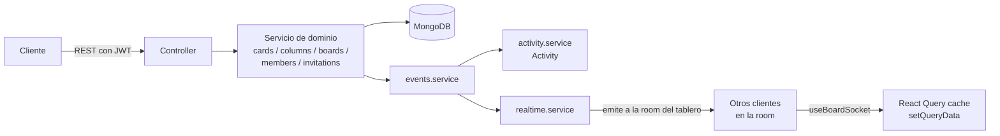

# MakeIt

Tablero Kanban colaborativo (tipo Trello) construido como proyecto de portfolio
full-stack: tableros con listas y tarjetas que se pueden reordenar, con varios
usuarios trabajando sobre el mismo tablero.

> **Estado: Fase 4 — colaboración y tiempo real.** Sobre la Fase 3 (drag &
> drop), ahora varios usuarios pueden trabajar a la vez en el mismo tablero:
> invitaciones por enlace con roles, gestión de miembros, historial de
> actividad y sincronización en vivo con Socket.io. Pendiente: despliegue
> (Fase 5).

## Stack

| Capa               | Tecnología                        |
| ------------------ | --------------------------------- |
| Frontend           | React 19 + Vite 6 + TypeScript    |
| Backend            | Node.js + Express 5 + TypeScript  |
| Tiempo real        | Socket.io                         |
| Base de datos      | MongoDB con Mongoose              |
| Contenedores       | Docker + Docker Compose           |
| Calidad            | ESLint 9 (flat config) + Prettier |
| Gestor de paquetes | npm                               |

## Requisitos

Para levantarlo con Docker (recomendado):

- Docker Engine 24+ con el plugin Docker Compose v2

Para ejecutarlo sin Docker:

- Node.js 20 o superior y npm
- Una instancia de MongoDB accesible (local o remota)

## Cómo levantarlo con Docker

Un único comando desde la raíz del repositorio:

```bash
docker compose up --build
```

No hace falta crear un `.env`: `docker-compose.yml` ya define valores por defecto
para todas las variables. Una vez arrancado:

- Cliente: http://localhost:5173
- API: http://localhost:4000/api/health
- MongoDB: `localhost:27017`

La página inicial consulta `/api/health` y muestra el estado de la API y de la
base de datos. El código de `/client` y `/server` está montado como volumen, así
que los cambios se recargan automáticamente sin reconstruir la imagen.

Comandos útiles:

```bash
docker compose up --build        # construir y arrancar
docker compose logs -f api       # seguir los logs de la API
docker compose down              # parar y eliminar los contenedores
docker compose down -v           # además, borrar los volúmenes (datos de Mongo y node_modules)
```

> El repo incluye un `Makefile` con atajos para estos comandos y para el
> flujo de desarrollo local (`make help` los lista todos; ver `MAKEFILE.md`
> para el detalle de cada uno). Por ejemplo: `make up`, `make smoke`,
> `make logs-api`, `make test`.

> `node_modules` de `api`/`client` vive en un volumen con nombre para que el
> `npm install` no se repita en cada arranque. Si añades una dependencia y
> `docker compose up --build` sigue fallando con un módulo "no encontrado",
> el volumen tiene el `node_modules` antiguo: bórralo con
> `docker compose down -v` (o `docker volume rm gestor_tareas_server-node-modules`)
> y vuelve a construir.

## Cómo ejecutarlo sin Docker

Necesitas un MongoDB corriendo en local. Desde la raíz:

```bash
cp .env.example .env     # y ajusta MONGO_URI a mongodb://localhost:27017/kanban
```

La API lee el `.env` de la raíz del monorepo y también `server/.env`, si existe
(este último tiene prioridad).

En una terminal, la API:

```bash
cd server
npm install
npm run dev              # http://localhost:4000
```

En otra terminal, el cliente:

```bash
cd client
npm install
npm run dev              # http://localhost:5173
```

El servidor de desarrollo de Vite proxea `/api` hacia `http://localhost:4000`,
de modo que no hay que configurar nada más en el cliente.

### Scripts disponibles

En `/server`:

| Script                  | Descripción                                             |
| ----------------------- | ------------------------------------------------------- |
| `npm run dev`           | Arranca la API con recarga automática (`tsx watch`)     |
| `npm run build`         | Compila TypeScript a `dist/`                            |
| `npm start`             | Ejecuta la build de `dist/`                             |
| `npm run lint`          | Analiza el código con ESLint                            |
| `npm test`              | Ejecuta los tests (Jest + Supertest + Mongo en memoria) |
| `npm run test:coverage` | Tests con informe de cobertura                          |
| `npm run seed`          | Crea un usuario y un tablero de ejemplo                 |

En `/client`:

| Script                  | Descripción                                        |
| ----------------------- | -------------------------------------------------- |
| `npm run dev`           | Servidor de desarrollo de Vite                     |
| `npm run build`         | Comprueba los tipos y genera el bundle en `dist/`  |
| `npm run preview`       | Sirve en local el bundle de producción             |
| `npm run lint`          | Analiza el código con ESLint                       |
| `npm test`              | Ejecuta los tests (Vitest + Testing Library + MSW) |
| `npm run test:watch`    | Tests en modo observador                           |
| `npm run test:coverage` | Tests con informe de cobertura                     |

## Estructura de carpetas

```
.
├── client/                     # Aplicación React (SPA)
│   ├── src/
│   │   ├── api/                 # Cliente HTTP (client.ts) + funciones por recurso
│   │   ├── stores/               # Zustand: sesión (authStore) y toasts (toastStore)
│   │   ├── types/api.ts          # Formas de la API en un único sitio
│   │   ├── lib/queryClient.ts    # Instancia de React Query
│   │   ├── components/           # UI reutilizable: Button, Input, Modal...
│   │   ├── routes/                # ProtectedRoute, PublicRoute, AppRouter
│   │   ├── features/
│   │   │   ├── auth/              # LoginPage, RegisterPage
│   │   │   ├── boards/             # Lista, vista de tablero, modales
│   │   │   ├── columns/            # Columnas: crear, renombrar, borrar
│   │   │   ├── cards/              # Tarjetas: alta, detalle
│   │   │   ├── board/              # Drag & drop: Board, Sortable*, colisiones,
│   │   │   │                       # anuncios, coordinate getter de teclado,
│   │   │   │                       # useBoardSocket, remoteReducers
│   │   │   ├── members/            # Miembros, invitaciones, aceptar invitación
│   │   │   └── activity/           # Panel de actividad, frases en español
│   │   ├── socket/                # Singleton de socket.io-client + contrato
│   │   │                           # de eventos (duplicado del servidor)
│   │   ├── test/                  # Setup de Vitest + MSW + doble del socket
│   │   ├── App.tsx / main.tsx
│   │   └── index.css              # Tailwind v4
│   ├── index.html
│   ├── vite.config.ts          # Proxy de /api + configuración de Vitest
│   ├── tsconfig*.json
│   ├── eslint.config.js
│   ├── Dockerfile              # Multi-stage: deps, dev, build, prod
│   └── .dockerignore
├── server/                     # API Express
│   ├── src/
│   │   ├── config/
│   │   │   ├── env.ts          # Carga con dotenv y validación con Zod
│   │   │   └── db.ts           # Conexión con Mongoose y estado de la BD
│   │   ├── models/             # User, Board, Column, Card, RefreshToken,
│   │   │                       # Invitation, Activity
│   │   ├── schemas/             # Validación de entrada con Zod
│   │   ├── services/            # Lógica de negocio (auth, boards, columns,
│   │   │                        # cards, members, invitations, activity,
│   │   │                        # events [único punto que registra actividad
│   │   │                        # Y emite por socket], realtime)
│   │   ├── controllers/         # Manejadores de las rutas, delgados
│   │   ├── routes/              # Definición de rutas
│   │   ├── middleware/          # requireAuth, requireBoardRole, validate,
│   │   │                        # mutationId (cabecera X-Mutation-Id), errores
│   │   ├── socket/              # Servidor de Socket.io: handshake, rooms,
│   │   │                        # presencia, contrato de eventos
│   │   ├── mailer/               # Interfaz Mailer + ConsoleMailer (dev)
│   │   ├── errors/AppError.ts   # Error tipado con código HTTP y código de error
│   │   ├── utils/               # calculatePosition, tokens, password, hash...
│   │   ├── types/                # Augmentations de Express (req.user, req.boardId)
│   │   ├── app.ts               # Construcción de la app de Express
│   │   ├── server.ts            # Arranque (http.Server + Socket.io) y apagado ordenado
│   │   └── seed.ts              # npm run seed: usuario + tablero de ejemplo
│   ├── tests/                   # Jest + Supertest + mongodb-memory-server
│   ├── tsconfig.json / tsconfig.test.json
│   ├── jest.config.js
│   ├── eslint.config.js
│   ├── Dockerfile               # Multi-stage: deps, dev, build, prod
│   └── .dockerignore
├── docker-compose.yml          # Servicios client, api y mongo
├── requests.http                # Peticiones de ejemplo para probar la API
├── .env.example                 # Todas las variables de entorno
├── .prettierrc                  # Configuración de Prettier compartida
├── .gitignore
└── README.md
```

## Variables de entorno

| Variable                 | Por defecto             | Descripción                                       |
| ------------------------ | ----------------------- | ------------------------------------------------- |
| `NODE_ENV`               | `development`           | Entorno de ejecución                              |
| `PORT`                   | `4000`                  | Puerto de la API                                  |
| `MONGO_URI`              | —                       | Cadena de conexión a MongoDB (obligatoria)        |
| `CORS_ORIGIN`            | `http://localhost:5173` | Origen permitido por CORS                         |
| `JWT_ACCESS_SECRET`      | —                       | Secreto del access token (obligatoria, ≥16 car.)  |
| `JWT_REFRESH_SECRET`     | —                       | Secreto del refresh token (obligatoria, ≥16 car.) |
| `JWT_ACCESS_EXPIRES_IN`  | `15m`                   | Vida del access token                             |
| `JWT_REFRESH_EXPIRES_IN` | `30d`                   | Vida del refresh token                            |
| `BCRYPT_ROUNDS`          | `10`                    | Coste de bcrypt para las contraseñas              |
| `INVITATION_EXPIRES_DAYS`| `7`                     | Días hasta que caduca una invitación pendiente    |
| `APP_BASE_URL`           | `http://localhost:5173` | Base para construir el enlace `/invite/:token`    |
| `APP_NAME`               | `MakeIt`                | Nombre usado en el asunto de las invitaciones     |
| `SOCKET_PATH`            | `/socket.io`            | Path del servidor de Socket.io                    |
| `MONGO_DB`               | `kanban`                | Base de datos usada por Compose                   |
| `MONGO_PORT`             | `27017`                 | Puerto publicado de MongoDB                       |
| `CLIENT_PORT`            | `5173`                  | Puerto publicado del cliente                      |

La API valida su configuración al arrancar con Zod: si falta una variable
obligatoria o algún valor es inválido, el proceso termina con un mensaje
explicando qué falla.

## API

Todas las rutas van bajo `/api`. Las que requieren autenticación esperan
`Authorization: Bearer <accessToken>`; `/api/auth/refresh` y `/api/auth/logout`
leen en su lugar la cookie `httpOnly` `refreshToken`. Las respuestas de error
tienen la forma `{ "error": { "code", "message", "details"? } }`.

| Método   | Ruta                           | Auth           | Descripción                                              |
| -------- | ------------------------------ | -------------- | -------------------------------------------------------- |
| `GET`    | `/api/health`                  | —              | Estado de la API y de la base de datos                   |
| `POST`   | `/api/auth/register`           | —              | Crea una cuenta; devuelve `accessToken` + cookie refresh |
| `POST`   | `/api/auth/login`              | —              | Igual que arriba, validando credenciales                 |
| `POST`   | `/api/auth/refresh`            | cookie refresh | Rota el refresh token; devuelve `accessToken` nuevo      |
| `POST`   | `/api/auth/logout`             | cookie refresh | Invalida el refresh token activo                         |
| `GET`    | `/api/auth/me`                 | token          | Usuario autenticado                                      |
| `GET`    | `/api/boards`                  | token          | Tableros donde el usuario es miembro                     |
| `POST`   | `/api/boards`                  | token          | Crea un tablero; el creador queda como `admin`           |
| `GET`    | `/api/boards/:id`              | token · viewer | Tablero con columnas y tarjetas ordenadas                |
| `PATCH`  | `/api/boards/:id`              | token · admin  | Edita título/descripción                                 |
| `DELETE` | `/api/boards/:id`              | token · admin  | Borra el tablero y sus columnas/tarjetas (cascada)       |
| `POST`   | `/api/boards/:boardId/columns` | token · editor | Crea una columna                                         |
| `PATCH`  | `/api/columns/:id`             | token · editor | Edita una columna                                        |
| `DELETE` | `/api/columns/:id`             | token · editor | Borra la columna y sus tarjetas (cascada)                |
| `PATCH`  | `/api/columns/:id/move`        | token · editor | Reordena la columna entre dos vecinas                    |
| `POST`   | `/api/columns/:columnId/cards` | token · editor | Crea una tarjeta                                         |
| `PATCH`  | `/api/cards/:id`               | token · editor | Edita una tarjeta                                        |
| `DELETE` | `/api/cards/:id`               | token · editor | Borra una tarjeta                                        |
| `PATCH`  | `/api/cards/:id/move`          | token · editor | Mueve la tarjeta de columna y/o posición                 |
| `GET`    | `/api/boards/:boardId/activity`| token · viewer | Historial del tablero, paginado por cursor               |
| `GET`    | `/api/cards/:id/activity`      | token · viewer | Historial de una tarjeta, paginado por cursor             |
| `GET`    | `/api/boards/:boardId/members` | token · viewer | Miembros del tablero (id, nombre, email, rol)             |
| `PATCH`  | `/api/boards/:boardId/members/:userId` | token · admin | Cambia el rol de un miembro                       |
| `DELETE` | `/api/boards/:boardId/members/:userId` | token · admin (a otro) o el propio usuario | Expulsa o abandona |
| `POST`   | `/api/boards/:boardId/invitations` | token · admin | Crea una invitación; devuelve el enlace con el token en claro |
| `GET`    | `/api/boards/:boardId/invitations` | token · admin | Invitaciones pendientes (no caducadas)                 |
| `DELETE` | `/api/invitations/:id`         | token · admin  | Revoca una invitación pendiente                           |
| `POST`   | `/api/invitations/accept`      | token          | Acepta una invitación con `{ token }`; idempotente         |

"viewer/editor/admin" es el rol mínimo exigido en ese tablero. Si el usuario no
es miembro del tablero, cualquiera de estas rutas responde `404` (no `403`,
para no revelar que el tablero existe). Las mutaciones (`POST`/`PATCH`/`DELETE`,
salvo `/auth/*`) aceptan una cabecera opcional `X-Mutation-Id`: viaja en el
payload del evento de socket correspondiente para que el cliente que originó
el cambio pueda ignorar su propio eco (ver "Colaboración y tiempo real").
`requests.http` en la raíz del repo tiene ejemplos listos para ejecutar con la
extensión REST Client de VS Code (o cualquier cliente compatible).

## Frontend

Stack: React + Vite + TypeScript estricto, React Router, TanStack Query,
Zustand, React Hook Form + Zod, Tailwind v4, dnd-kit, socket.io-client. Tests
con Vitest + Testing Library + MSW (socket mockeado, ver `test/socketMock.ts`).

### Interfaz y tema

Rediseño ("Makeit") inspirado en un panel de seguimiento de tareas: sidebar
oscuro fijo (logo, "Mis tableros", "+ Nuevo tablero") y contenido claro u
oscuro según el interruptor de la cabecera. El tema se guarda en
`localStorage` (store `themeStore.ts`, con `zustand/persist`) y, si no hay
preferencia guardada, arranca según `prefers-color-scheme` del sistema. Las
etiquetas de las tarjetas y el avatar de la empresa usan un color
determinista por texto (`lib/badgeColors.ts`): mismo texto, mismo color
siempre, sin guardar un campo de color en el modelo de datos.

### Cómo se gestiona la sesión

- El **access token vive solo en memoria**, en un store de Zustand
  (`stores/authStore.ts`). Nunca se escribe en `localStorage` ni
  `sessionStorage`: si se recarga la página o se abre una pestaña nueva, no
  queda rastro de él en el navegador.
- El **refresh token vive en una cookie `httpOnly`** que gestiona el
  servidor; JavaScript no puede leerla ni manipularla. El cliente HTTP
  (`api/client.ts`) usa `credentials: 'include'` en cada petición para que el
  navegador la envíe y reciba sola.
- Al cargar la app (`App.tsx`), se llama una vez a `POST /api/auth/refresh`
  mientras se muestra una pantalla de carga de página completa. Si hay cookie
  válida, se recupera el access token y el usuario (`GET /api/auth/me`) sin
  que el usuario tenga que volver a iniciar sesión; si no, pasa a
  `unauthenticated` y `ProtectedRoute` redirige a `/login`.
- Si una petición autenticada responde `401` (access token caducado),
  `api/client.ts` hace **un único** `POST /api/auth/refresh` y reintenta esa
  petición una sola vez. Varias peticiones que fallan a la vez (p. ej. al
  recargar con varias queries en paralelo) comparten la misma promesa de
  refresh en lugar de disparar varias llamadas — ver "Decisiones técnicas".
  Si el refresh también falla, se limpia la sesión y `ProtectedRoute`
  redirige a `/login` de forma reactiva (no hay un `window.location.href`
  manual en medio de la lógica de red).
- `logout` llama a `POST /api/auth/logout` y limpia la sesión y la cache de
  React Query (`queryClient.clear()`) tanto si la petición tiene éxito como
  si falla: la sesión local no debe quedar "colgada" por un fallo de red.

### Capturas de pantalla

_Pendiente: añadir capturas de /login, /boards y la vista de un tablero._

### Arrastrar y soltar (drag & drop)

Tarjetas (dentro de una columna, entre columnas, a una vacía) y columnas
(para reordenarlas) se arrastran con [dnd-kit](https://dndkit.com/). Todo el
código vive en `features/board/`:

- **`boardReducers.ts`**: la lógica pura (sin React ni dnd-kit) que mueve
  tarjetas/columnas dentro de la estructura del tablero y deriva lo que hay
  que mandarle a la API. Se apoya en el **orden del array**, no en `position`:
  mover una tarjeta es recortarla de un array e insertarla en otro por
  índice, así que la vista previa durante el arrastre nunca necesita conocer
  ni recalcular posiciones numéricas.
- **El contrato con el backend no cambió**: `PATCH /api/cards/:id/move` y
  `PATCH /api/columns/:id/move` ya recibían ids de vecinos (`prevCardId` /
  `nextCardId`, o sus equivalentes de columna) y devuelven el servidor
  calculando la posición — nunca un número calculado por el cliente. El
  cliente solo deriva esos ids a partir del índice donde soltaste (ver
  `cardMoveApiInput` / `columnMoveApiInput`).
- **Rebalanceo de `position` (ajuste de backend de esta fase)**: cada
  movimiento biseca el hueco entre dos vecinos (`calculatePosition`); tras
  muchas inserciones seguidas en el mismo hueco, ese punto medio se vuelve
  indistinguible de sus vecinos en punto flotante. Si el hueco baja de un
  umbral, el servidor renumera **todos** los hermanos (de la columna, o del
  tablero) como múltiplos de 1000 en vez de seguir biseccionando —
  transparente para el cliente, que siempre refresca el tablero tras cada
  movimiento.
- **Estrategia de colisiones propia**: prioriza una tarjeta concreta bajo el
  puntero sobre la columna que la contiene (inserción precisa), con la
  columna como respaldo para huecos y columnas vacías, y `rectIntersection`
  como última red si el puntero se sale un instante durante un arrastre
  rápido.
- **Teclado**: `KeyboardSensor` con un _coordinate getter_ propio — cada
  columna tiene su propio `SortableContext` vertical, así que ↑/↓ reordena
  dentro de la columna y ←/→ salta a la columna vecina.

### Vista de lista (alternativa al arrastre)

Cada tablero tiene un selector **Tablero / Lista** sobre el propio tablero
(`BoardPage.tsx`). La vista de lista (`features/board/BoardListView.tsx`)
muestra todas las tarjetas en una sola columna, sin arrastre: a la derecha de
cada tarjeta hay un botón por cada categoría del tablero, coloreado igual que
sus etiquetas, con la categoría actual marcada con un anillo; pulsar otro
botón mueve la tarjeta al final de esa columna. Reutiliza exactamente el
mismo `useMoveCardMutation`/`applyCardMove`/`cardMoveApiInput` que el
arrastre — la lógica de `boardReducers.ts` no sabe ni le importa si el
movimiento vino de un gesto de arrastre o de un clic, así que ambas vistas
quedan siempre sincronizadas entre sí.

### GIF de demostración

_Pendiente: grabar un GIF arrastrando una tarjeta entre columnas._

_Pendiente: grabar un GIF con dos ventanas mostrando la colaboración en vivo
en MakeIt (mover una tarjeta en una y verla actualizarse al instante en la
otra)._

## Colaboración y tiempo real

Varias personas pueden trabajar a la vez en el mismo tablero: invitaciones
por enlace con rol, gestión de miembros, historial de actividad y
sincronización en vivo con [Socket.io](https://socket.io/). La lógica de
tiempo real está escrita para ser independiente del layout visual (opera
sobre la cache de React Query, no sobre el DOM del tablero), así que el
rediseño de una fase posterior no debería tener que tocarla.

### Flujo



- **Las escrituras siempre van por REST**; el socket solo difunde. El cliente
  que origina el cambio ya tiene su propia respuesta (optimista, desde la
  Fase 3) y no depende del socket para verse a sí mismo — ver "Decisiones
  técnicas" para el porqué.
- **`events.service.publish(...)`** es el único punto desde el que se
  registra actividad y se emite por socket; lo llaman los servicios de
  dominio tras cada mutación con éxito, nunca los controllers, así no se
  olvida ningún caso. `board:updated`/`board:deleted` son la excepción: no
  hay tipo de actividad para el tablero en sí (Parte 2 solo cubre tarjetas,
  columnas y miembros), así que `boards.service` emite directo por
  `realtime.service`.

### Eventos de socket

Autenticación en el handshake con el access token JWT (`auth: { token }`,
verificado con la misma lógica que `requireAuth`); sin token válido se
rechaza la conexión. `board:join { boardId }` solo admite a quien es miembro
(comprobado en Mongo) y une al socket a la room `board:{id}`; un no-miembro
recibe `{ error: 'FORBIDDEN' }` sin que se revele si el tablero existe.
`board:leave { boardId }` es el inverso. El contrato completo
(`SocketEventPayloads`) vive en `server/src/socket/events.ts`, duplicado
literalmente en `client/src/socket/events.ts` (el cliente no puede importar
código del servidor en el build de Vite); un test en ambos lados compara los
dos archivos para detectar divergencias.

| Evento              | Payload                                                   |
| -------------------- | ---------------------------------------------------------- |
| `card:created`       | `{ card, actorId, clientId? }`                             |
| `card:updated`       | `{ card, actorId, clientId? }`                             |
| `card:moved`         | `{ card, actorId, clientId? }`                             |
| `card:deleted`       | `{ cardId, columnId, actorId, clientId? }`                 |
| `column:created`     | `{ column, actorId, clientId? }`                           |
| `column:updated`     | `{ column, actorId, clientId? }`                           |
| `column:moved`       | `{ column, actorId, clientId? }`                           |
| `column:deleted`     | `{ columnId, actorId, clientId? }`                         |
| `board:updated`      | `{ board, actorId, clientId? }`                             |
| `board:deleted`      | `{ boardId, actorId }`                                      |
| `member:joined`      | `{ member: { userId, role, name?, email? }, actorId }`     |
| `member:updated`     | `{ member: { userId, role, name?, email? }, actorId }`     |
| `member:removed`     | `{ userId, actorId }`                                       |
| `activity:created`   | `{ activity }`                                               |
| `presence:update`    | `{ users: [{ userId, name, initials }] }`                  |

`clientId` es el `TAB_ID` del cliente que originó el cambio (una cadena
aleatoria por pestaña, generada una vez al cargar `socket/clientId.ts`, no
por usuario) — viaja como cabecera `X-Mutation-Id` en la petición REST y
vuelve en el payload del evento. `useBoardSocket` lo compara con su propio
`TAB_ID` para ignorar el eco de sus propias mutaciones **sin** ignorar las de
otra pestaña del mismo usuario (que sí debe actualizarse).

**Presencia**: `socket/presence.ts` mantiene un `Map<boardId, Map<userId,
Set<socketId>>>` en memoria; varias pestañas del mismo usuario cuentan como
una sola conexión y solo desaparecen de la lista cuando se cierra la
última. Se emite `presence:update` al entrar, salir o desconectarse.

**Límites**: `maxHttpBufferSize` bajo (los únicos eventos de cliente son
`board:join`/`board:leave`, con un id) y una ventana deslizante simple en
memoria por `socket.id` para limitar la frecuencia de esos dos eventos.

**Escalar a varias instancias (no implementado, solo documentado)**: con más
de un proceso de la API, cada uno tendría su propio Map de presencia y sus
propias rooms en memoria — un cliente conectado a la instancia A nunca
recibiría los eventos emitidos desde la instancia B. Haría falta el
[adapter de Redis para Socket.io](https://socket.io/docs/v4/redis-adapter/)
(`@socket.io/redis-adapter`), que reemplaza el adapter en memoria por uno
que publica/suscribe los eventos entre instancias vía Redis.

### Invitaciones

`POST /api/boards/:boardId/invitations` genera un token aleatorio
(`crypto.randomBytes(32)`), guarda solo su hash SHA-256 (`Invitation.tokenHash`,
igual que `RefreshToken`) y devuelve el token en claro **una vez**, dentro del
enlace `APP_BASE_URL/invite/<token>`. No se envían emails reales: la interfaz
`Mailer` (`server/src/mailer/Mailer.ts`) tiene una implementación de
desarrollo (`ConsoleMailer`) que escribe el mensaje en los logs del servidor,
lista para sustituirse por un proveedor real sin tocar quien la usa.

La ruta `/invite/:token` del cliente vive bajo `ProtectedRoute`: si no hay
sesión, el redirect habitual a `/login` (con `state: { from: location }`) ya
hace que, tras iniciar sesión o registrarse, se vuelva exactamente a esa URL
y se acepte la invitación automáticamente. Pantallas para token inválido,
caducado, revocado o ya usado; aceptar dos veces es idempotente (no duplica
el miembro).

**Reglas de integridad**: el tablero siempre conserva al menos un admin (no
se puede degradar, expulsar ni abandonar siendo el último) y el propietario
original nunca puede ser expulsado (sí se le puede cambiar el rol si queda
otro admin). `members.service.ts` centraliza ambas comprobaciones.

### Actividad

Un historial por tablero (y uno filtrado por tarjeta) de qué pasó, quién y
cuándo, con paginación por cursor (`createdAt` del último elemento,
descendente). Los tipos registrados: `card.created/updated/moved/deleted`,
`column.created/renamed/moved/deleted`, `member.joined/left/removed/role_changed`.
`data` guarda **títulos y nombres en el momento del evento**, no referencias,
así el historial sigue teniendo sentido aunque la tarjeta/columna se borre o
se renombre después.

**Agrupado de ruido**: si la actividad más reciente de una tarjeta ya es un
`card.updated` del mismo autor hace menos de 60 segundos, el nuevo evento se
funde en esa fila (mismo `createdAt`, `data` actualizada) en vez de crear una
nueva — pensado para ediciones de contenido seguidas (escribir una
descripción, corregir un título). El resto de tipos nunca se agrupan: crear,
mover, borrar o los eventos de miembros son hechos discretos que se esperan
ver todos.

**Retención**: índice TTL sobre `createdAt` a 180 días (mismo patrón que
`RefreshToken`), para que la colección no crezca sin límite.

## Decisiones técnicas

- **Columnas y tarjetas en colecciones separadas, no embebidas en `Board`.**
  Con tableros colaborativos, embeber tarjetas en el documento del tablero
  obligaría a reescribir ese documento completo en cada movimiento —riesgo de
  condiciones de carrera entre usuarios editando a la vez— y no permitiría
  indexar ni paginar tarjetas de forma independiente. Con referencias, cada
  movimiento es un `update` puntual por `_id`, e índices compuestos como
  `{ column: 1, position: 1 }` hacen barata la consulta "tarjetas de esta
  columna, en orden".
- **`calculatePosition(prev, next)` como punto medio entre vecinos**, en vez de
  un entero secuencial. Insertar o mover un elemento solo actualiza su propia
  fila; nunca hace falta renumerar el resto de la lista. Limitación conocida y
  aceptada en esta fase: tras muchísimas inserciones consecutivas en el mismo
  hueco, la precisión de punto flotante se agota (necesitaría un rebalanceo
  periódico, fuera de alcance de la Fase 1).
- **Refresh token como JWT con `jti`, no un simple valor aleatorio.** Permite
  verificar la firma y la expiración sin consultar la base de datos antes de
  mirar la tabla de revocación. Solo se guarda en Mongo el hash SHA-256 del
  token (nunca el valor en claro) junto con su `jti`, y cada `/refresh` borra
  la fila usada y crea una nueva (rotación): un token robado y luego usado por
  su dueño legítimo invalida la copia del atacante en el siguiente refresh.
- **`bcryptjs` en vez de `bcrypt`.** Implementación en JavaScript puro: evita
  añadir un toolchain de compilación nativa a la imagen `node:24-alpine`.
- **No-miembro → 404, miembro sin rol suficiente → 403.** Un no-miembro no
  debe poder confirmar que un tablero existe; un miembro ya sabe que existe,
  así que un 403 no filtra información nueva.
- **Autorización centralizada en `requireBoardRole(minRole, resolveBoardId)`.**
  El resolver recibe la request y devuelve el id del tablero, bien directo
  (`req.params.id`) o cargando primero la columna/tarjeta padre. Así la lógica
  de "verificar membresía + rango de rol" vive en un solo sitio para los tres
  recursos.
- **Controllers delgados, lógica en `services/`.** Los controllers solo leen
  la request, llaman al servicio correspondiente y dan forma a la respuesta;
  las reglas de negocio (cascadas, siembra de plantillas, validaciones cruzadas
  entre tablero/columna/tarjeta) viven en `services/`, reutilizables y testeables
  sin pasar por HTTP.
- **TanStack Query para el estado de servidor, Zustand solo para sesión y
  toasts.** Tableros, columnas y tarjetas vienen siempre de la API: React
  Query ya resuelve cache, invalidación y los estados de carga/error que
  pide el enunciado, sin reinventar nada de eso a mano. Zustand se usa
  únicamente para los dos trozos de estado que _no_ son del servidor (el
  usuario autenticado y los toasts); mezclar ambos en un solo store habría
  forzado a sincronizar manualmente algo que React Query ya gestiona.
- **Access token en memoria (Zustand) y refresh en cookie `httpOnly`.**
  Guardar el access token en `localStorage`/`sessionStorage` lo expone a
  cualquier script que corra en la página (XSS); en memoria desaparece al
  cerrar la pestaña o recargar, y se recupera en el acto con `/auth/refresh`
  gracias a la cookie, que JavaScript nunca llega a tocar. Es el mismo
  reparto de responsabilidades que ya tenía el backend desde la Fase 1
  (cookie `httpOnly` + rotación del refresh); el cliente solo tenía que
  respetarlo.
- **Un único refresh para varias peticiones 401 simultáneas.**
  `api/client.ts` guarda la promesa del refresh en curso en una variable de
  módulo (`refreshPromise`). La primera petición que recibe un 401 crea esa
  promesa y lanza el `POST /auth/refresh`; cualquier otra petición que falle
  mientras tanto reutiliza la misma promesa en vez de disparar su propio
  refresh. Al resolverse (o fallar), la variable se limpia en un `finally`
  para que el siguiente 401 pueda abrir un refresh nuevo.
- **`CardDetailModal` deriva la tarjeta activa por id, no por una copia
  guardada.** `BoardPage` guarda solo `activeCardId` y busca la tarjeta en
  los datos ya cargados del tablero en cada render; así, tras guardar o
  mover la tarjeta, el modal siempre muestra los datos frescos que llegan al
  invalidar la query, en vez de una foto fija del momento en que se abrió.
- **`Modal` escucha Escape en `document`, no solo en el propio contenedor.**
  La primera versión cerraba el diálogo con un `onKeyDown` en el contenedor,
  que depende de que el foco esté dentro; tras una mutación que vuelve a
  renderizar el contenido, el foco puede acabar fuera del diálogo y Escape
  dejaba de hacer nada. Encontrado verificando el flujo completo en un
  navegador real (en la Fase 2, antes de que esta pantalla tuviera drag & drop).
- **dnd-kit, no `react-beautiful-dnd`.** `react-beautiful-dnd` está
  archivada y sin mantenimiento; dnd-kit sigue activa, no depende de
  `react-dom`'s legacy APIs, y separa limpio sensores / detección de
  colisiones / estrategia de orden, que es justo lo que hacía falta
  personalizar aquí (colisiones propias, `KeyboardSensor` con coordinate
  getter a medida).
- **Posiciones numéricas con punto medio, no reescribir índices.** Si el
  orden se guardara como un índice entero por tarjeta (0, 1, 2...), mover una
  tarjeta al principio de una columna con 50 tarjetas implicaría reescribir
  las 50. Con `position` numérica y `calculatePosition(prev, next)`, mover
  una tarjeta es _una_ escritura: la suya. El coste es el de siempre con
  claves flotantes (el hueco se agota tras muchas inserciones seguidas en el
  mismo sitio), resuelto con el rebalanceo descrito arriba — mismo
  compromiso que ya se documentó en la Fase 1, ahora con la pieza que
  faltaba.
- **Cómo se evitan condiciones de carrera entre arrastres.** Dos cosas
  combinadas: (1) `scope: { id: 'board-' + boardId }` en las mutaciones de
  mover — TanStack Query encola las mutaciones del mismo scope, así que dos
  arrastres seguidos sobre el mismo tablero nunca corren en paralelo ni se
  pisan; (2) el estado visual del arrastre (`dragPreview` en `Board.tsx`) es
  independiente de la cache y no se limpia hasta que **todas** las
  mutaciones de arrastre en curso han asentado (contador de pendientes), así
  que aunque la segunda mutación quede esperando en la cola, la pantalla
  nunca "retrocede" al orden anterior mientras espera — ver la sección de
  drag & drop más arriba para el detalle completo.
- **El socket solo difunde; las escrituras siempre van por REST.** Si las
  mutaciones también pudieran llegar por socket, habría dos caminos de
  validación/autorización/Zod que mantener sincronizados. Con un único
  camino de escritura, el cliente que origina un cambio ya tiene su propia
  respuesta (optimista, desde la Fase 3) sin depender del socket para verse
  a sí mismo, y el socket se reduce a "avisar a los demás" — más simple y
  con una sola fuente de verdad para los permisos.
- **Eco propio por `clientId` de pestaña, no por `actorId`.** Comparar solo
  por `actorId` bastaría para que un cliente ignore sus propias mutaciones,
  pero rompería el caso de dos pestañas abiertas con el mismo usuario: la
  pestaña que NO hizo el cambio también lo ignoraría al compartir el mismo
  `actorId`, y se quedaría desincronizada. `TAB_ID` (aleatorio por pestaña,
  `socket/clientId.ts`) viaja como cabecera `X-Mutation-Id` en la mutación
  REST y vuelve en el payload del evento; `useBoardSocket` solo ignora el
  evento si el `clientId` coincide con el de su propia pestaña. Esto, sumado
  a que los eventos remotos se aplican con `setQueryData` (no con un
  refetch completo), es lo que evita el parpadeo con las actualizaciones
  optimistas de la Fase 3: la cache nunca "salta" a un estado intermedio
  del servidor que luego el propio cliente tendría que corregir otra vez.
- **Eventos remotos durante un arrastre: se aplican a la cache, no a la
  vista.** `Board.tsx` ya deriva `liveBoard = dragPreview ?? board`
  (Fase 3); mientras `dragPreview` no es `null` cualquier escritura en la
  cache del tablero queda oculta tras él automáticamente, así que un evento
  remoto nunca reordena ni hace parpadear la vista en mitad de un arrastre
  propio — no hizo falta tocar `Board.tsx` para ese caso general. El único
  caso que sí necesitaba código nuevo es que el evento remoto afecte
  justo al elemento que este cliente está arrastrando: `Board.tsx` escribe
  qué se arrastra en un `ref` compartido (no estado, para no provocar
  renders) y `useBoardSocket` lo compara con cada `card:moved`/`card:deleted`/
  `column:moved`/`column:deleted` remoto; si coincide, cancela el arrastre
  despachando un `keydown` de `Escape` sintético en `window` (dnd-kit
  escucha Escape de forma global mientras cualquier sensor tiene un
  arrastre activo, no solo `KeyboardSensor`) y avisa con un toast.
- **Autenticación del socket con el mismo access token JWT que REST.** El
  handshake manda `auth: { token }` (una función, no un objeto fijo, para
  que cada intento de conexión relea el token más reciente del store de
  Zustand) y el servidor lo verifica con la misma función que usa
  `requireAuth`; sin token válido se rechaza la conexión entera. Evita un
  segundo mecanismo de autenticación (sesiones de socket, cookies propias)
  solo para esto.
- **Tokens de invitación hasheados (SHA-256), nunca guardados en claro.**
  Mismo razonamiento que el refresh token (Fase 1): un volcado de la base de
  datos no debería bastar para suplantar una invitación pendiente. El token
  en claro solo existe en la respuesta de creación (una vez) y en el enlace
  que recibe la persona invitada; el servidor solo necesita poder comparar
  hashes para validarlo al aceptar.

## Roadmap

- ~~Fase 2: frontend funcional (registro, login, tableros, columnas, tarjetas).~~
- ~~Fase 3: drag & drop para reordenar y mover columnas/tarjetas.~~
- ~~Fase 4: tiempo real entre colaboradores (Socket.io), invitaciones y
  gestión de miembros de un tablero.~~
- Fase 5: despliegue.
